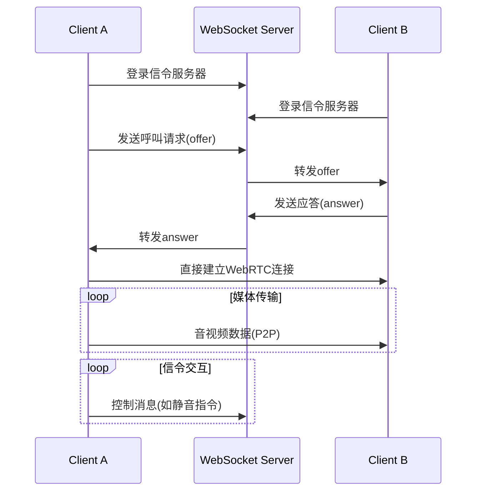

# Redis

Redis 6.0 在 2020 年发布

- ACL / TLS (Azure Redis 2014)
- CLIENT TRACKING
- STREAMS (并未应用)
- 动态 hz 
  - 连接数 > 2000
- RESP 3 协议

Redis 7.0

- shard channels

`server.c` 中 `call` 命令是核心方法

### 事件驱动

- 基于 epoll
- clients / client_to_close 链表

## Channel

- kvstore 记录订阅
- dict 记录模式订阅

### anet.c

TCP_NODELAY=1，默认禁用 NAGLE 算法

#### IPv4 vs IPv6

ipv4 动态 header 20~60 bytes

ipv6 固定 header 40 byte

源/目标地址：4 -> 16，+24 byte，同时 IHL，Flags, checksum 等字段被移除

IHL - 固定 40byte
checksum - 依赖上层协议 

Flags - 3 bit，DF/MF (don't/more)

TTL -> Hop Limit

#### Traceroute 工作原理

发送 TTL=1,2,3,4... 的包，利用 ICMP 现实路径，每经过一个设备 -1, 0 的时候丢弃

#### NAGLE 算法

- 等待前一个包的 ACK 再发
- 或积累到超过 MSS（通常 1460 bytes）
- MSS 可以调节，

ipv4: MTU (1500) - TCP header (20) - IPv4 header (20)
ipv6: MTU (1500) - TCP header (20) - IPv6 header (40)

### 数据结构

- sds
- rdlist (double-linked list), pub/sub clients
- rdx (radix tree)
- quicklist 
- ziplist（级联更新问题）
  Hash (512) / List 元素比较少的时候
- listpack (Redis 7.0+), 值长度 < 64

- Hash
  - listpack, < 512
  - listpack_ex
  - dict

- Set
  - intset, < 512
  - listpack, < 128
  - dict

- List
  - ziplist/listpack, < 512
  - quicklist

- ZSet
  - ziplist/listpack, < 128
  - skiplist + dict

### 过期机制

- 被动删除
- 主动删除
  - 快速模式, 1ms, 每秒一次
    - 最多删除 10000 / server.hz 
    - 1 <= server.hz <= 500, default: 10
  - 慢速模式
    - 动态调整 maxToExpire, factor = min(32, activeExpires / 1M)
    - 32 防止阻塞

数据结构：ebuckets

### 持久化 (Persistence)

#### AOF (Append-Only File)

日志重放，影响性能

- always, 吞吐量下降 50%
- appendfsync everysec，下降 ~20%
- appendfsync no，下降 5%， 但可能丢失 30s 数据

AOF 最好配置在 SSD 上

工作原理

- 记录 RESP 协议命令
- 文件重写
  - fork
  - 父进程双写 (aof.old + aof_rewrite_buf)
  - 子进程生成新 aof.new
  - 子进程结束后，父进程追加 buf 到 aof.new
  - rename 原子操作，close & reopen
- 混合持久化（RDB + AOF）

#### TLB vs Pages

#### Web RTC



#### RDB 

- SAVE, 基本不推荐
- BGSAVE, fork，约 1s/GB
  - 额外内存消耗，cow，取决于写入量
  - COW 根据内存页大小
  - 压缩比例大约 50%-70%

建议禁用透明大页 (Transparent Huage Pages)，降低 cow 性能，

```bash
echo never > /sys/kernel/mm/transparent_hugepage/enabled
echo never > /sys/kernel/mm/transparent_hugepage/defrag (关闭内存整理)
```

混合部署，redis 不会默认标记内存大页

```bash
echo madvise > /sys/kernel/mm/transparent_hugepage/enabled
echo defer > /sys/kernel/mm/transparent_hugepage/defrag  # 延迟碎片整理
```

也可使用 madvise 模式，redis 默认不会标记内存

```bash
# 查看 redis 延迟
redis-cli --latency-history -i 5  # 每5秒采样一次延迟
```

### 内存回收

NUMA 架构：每个 CPU socket 对应一个节点，访问本地节点比其他节点快 20%，每个节点有自己的 zone

```bash
# 查看 cpu socket 数量和 NUMA 节点数量
lscpu | grep "Socket(s)"

# 查看每个 NUMA 节点的内存大小
numactl --hardware
```

多 NUMA 建议绑定至单一节点

```bash
# 内存页在所有 NUMA 节点间均匀分布，减少跨节点访问延迟
numactl --interleave=all redis-server

# 数据集较小的话绑定到单个 NUMA 节点
numactl --cpunodebind=0 --membind=0 redis-server
```

zone_reclaim_mode，控制内存回收行为

- 0x1, 区域回收，回收本地内存
- 0x10，写入脏页到磁盘，回收内存
- 0x100，使用 swap 回收内存
- 0x1000，压缩并进行回收


### 主从复制 (REPL)

REPL: 主从复制

### 淘汰策略

- LRU
- LFU
- Random
- TTL
- (disable)

### ACL (redis 6.0 新特性)

基于 key 或频道的权限控制

### 客户端缓存跟踪 (redis 6.0 新特性)

RESP 3 协议，Azure Redis 应支持，需要查看版本

- server-assisted, server 会发送 invalidate 消息
- broadcasting

#### CLIENT_TRACKING

- REDIRECT 重定向到其他 client
- BCAST 广播模式或 PREFIX 匹配

服务端用 Radix Tree 记录 key 和 client 的映射关系

client 仍然是个 rdx，用来实现 client 高效的插入和删除

### call

`dirty` 值用于记录一个命令是否修改了数据集，单线程应用

I/O 多路复用（epoll / select）

### initServer

1. 初始化数据结构
   - rax
     - clients_index
     - clients_timeout_table
   - adlist
     - clients
     - clients_to_close
     - clients_pending_write
     - clients_pending_read
     - unblocked_clients
     - tracking_pending_keys
     - pending_push_messages
     - clients_waiting_acks
     - postponed_clients
     
1. 初始化 el, event loop
2. 初始化 db, default = 16
3. 初始化 LRU (evict.c -> evictionPoolAlloc)
4. 初始化 channels / patterns / shared channels
5. RDB 
6. ACL
7. 注册 serverCron

- 32 位机器最多使用 3G 内存


### serverCron

每秒调用 server.hz 次

1. dynamic `server.hz`
   - 200 connections / hz
   - hz 默认为 10
   - hz 翻倍
2. call `clientsCron`

### clientsCron

1. iterations = num_clients / hz
   - 保证每个 client 每秒被处理一次
2. move client head to rear
3. 处理 connection
   - 清理 idle 连接
   - 清理缓冲区
4. 根据上次内存用量分桶

### databaseCron

1. 随机采样的方式处理过期 key
   - master, `activeExpireCycle` (slow)
     - timelimit_exit, check every 16 iterations
     - `expires_cursor` 记录上一次扫描到的位置

   - slave, `expireSlaveKeys`


redis thread 4MB stack size