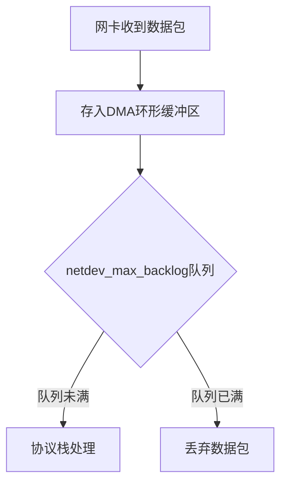

# Congestion control

BBR vs CUBIC (linux default)

- avoid bufferbloat

```bash
# net.ipv4.tcp_rmem = 4096 87380 6291456
# net.ipv4.tcp_wmem = 4096 16384 4194304
net.core.rmem_default=65536 # 200K
net.core.wmem_default=65536 # 200K

net.core.somaxconn = 65535 # 4096

sysctl -w net.ipv4.tcp_rmem="4096 16384 65536"
sysctl -w net.ipv4.tcp_wmem="4096 16384 65536"  # 小缓冲区
sysctl -w net.ipv4.tcp_congestion_control=bbr

# 低延迟模式
net.ipv4.tcp_low_latency=1
net.ipv4.tcp_no_metrics_save=0
net.ipv4.tcp_limit_output_bytes=1048576
net.ipv4.tcp_sack=1
net.ipv4.tcp_timestamps=1
```

# HTTPS

TLS 中止，ALPN 协议

# HTTP/2

frame based
  - HEADERS
  - DATA
  - PRIORITY
  - RST_STREAM
  - SETTINGS
  - PUSH_PROMISE
  - PING
  - GOAWAY


- 强制 TLS

## HPACK

- 静态表 (static table)
- 动态表

##


## QUIC
- Stream API
- Datagram API

|                     | TCP                     | HTTP/2                             | QUIC                        |
| ------------------- | ----------------------- | ---------------------------------- | --------------------------- |
| Fast open           | `net.ipv4.tcp_fastopen` |                                    |                             |
| Encryption          | 1~2 RTT (TLS1.2/1.3)    | TLS1.3, 0~1 RTT                    |                             |
|                     |                         | merge tls and transport handshakes |                             |
| Reliability         | retransimission         |                                    | QUIC handles                |
| Multiplexing        | N/A                     | streams, but HOL-blocking          | independent streams         |
| Performance on Loss | `net.ipv4.tcp_sack`     | slow                               | only affected single stream |

```bash
# 查看TCP重传率（应<0.1%）
nstat -z -a | grep -E "TcpRetransSegs|TcpOutSegs"
```

- RACK, SACK

tcp_fastopen 后续减少一个 RTT

TFO, 首次 sync 携带数据

```bash
cat /proc/sys/net/ipv4/tcp_fastopen_key # 300s expires
```

RTT, BDP



kestrel buffersize 1024KB

WebSocketOptions ReceiveBufferSize = 4KB

TCP_NODELAY (Nagle algorithm)

TCP zero window 

# Buffer

ss -ntmp | grep -A 10 <IP:PORT>

cat /proc/net/sockstat

## Commands

- iperf3
- ping / tcpping
  ```bash
  yum install tcptraceroute
  ```
- wsbench (Golang)

## Golang

websocket framework: gorilla

mutex: spin (4) + suspend

goroutine context switch: 300-500ns