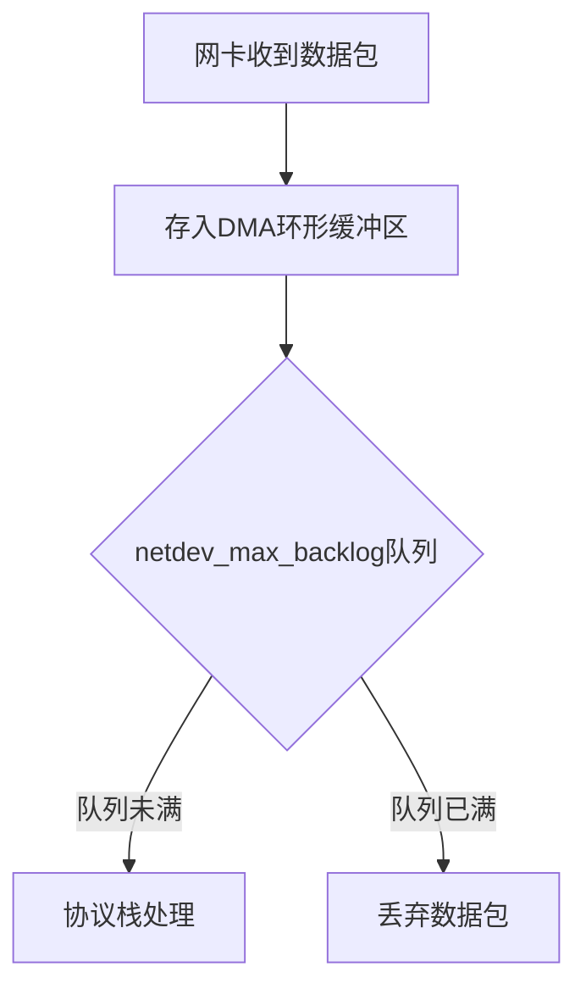

# Congestion control

BBR vs CUBIC (linux default)

- avoid bufferbloat

```bash
# net.ipv4.tcp_rmem = 4096 87380 6291456
# net.ipv4.tcp_wmem = 4096 16384 4194304
net.core.rmem_default=65536 # 200K
net.core.wmem_default=65536 # 200K

net.core.somaxconn = 65535 # 4096

sysctl -w net.ipv4.tcp_rmem="4096 16384 65536"
sysctl -w net.ipv4.tcp_wmem="4096 16384 65536"  # 小缓冲区
sysctl -w net.ipv4.tcp_congestion_control=bbr

# 低延迟模式
net.ipv4.tcp_low_latency=1
net.ipv4.tcp_no_metrics_save=1
net.ipv4.tcp_limit_output_bytes=32768
net.ipv4.tcp_sack=0
net.ipv4.tcp_timestamps=0
```

```bash
# 查看TCP重传率（应<0.1%）
netstat -s | grep retrans
```

tcp_fastopen 后续连接减少一个 RTT

RTT, BDP



kestrel buffersize 1024KB

WebSocketOptions ReceiveBufferSize = 4KB

TCP_NODELAY (Nagle algorithm)

TCP zero window 

# Memory

update memory limit every minutes, via cgroup

# Buffer

ss -ntmp | grep -A 10 <IP:PORT>

cat /proc/net/sockstat

# Redis

pub/sub 双写，接收端去重

## Commands

- iperf3
- ping / tcpping
  ```bash
  yum install tcptraceroute
  ```
- wsbench (Golang)

## Golang

websocket framework: gorilla

mutex: spin (4) + suspend

goroutine context switch: 300-500ns